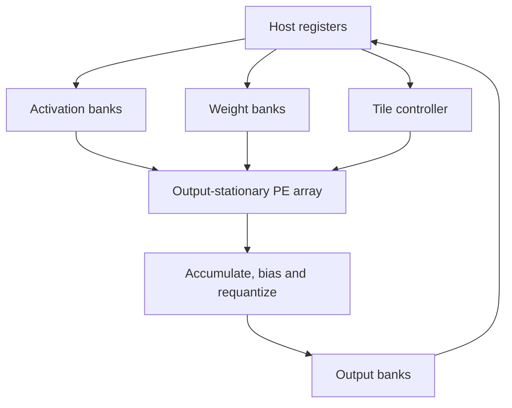

# Architecture

## Dataflow and scheduling

A PE signs its INT8 operands, multiplies into 16 bits, and adds the sign-extended product into its INT32 accumulator when both valid flags are set. An advancing clock also forwards A east and B south. A synchronous clear resets the partial and valid flags between tiles. The multiplication adds modulo 2³² if the PE is used outside TensorForge. TensorForge bounds K at 32, so no raw dot product exceeds 524,288 in magnitude.

For output tile origins `tm, tn` and reduction tile origin `tk`, row r sees `A[tm+r, tk+s-r]` and column c sees `B[tk+s-c, tn+c]` at stream step s. Each operand takes one additional clock per neighbor hop. PE (r,c) therefore combines reduction index `tk+i` at step `i+r+c`. Boundary enables keep invalid lanes and out-of-tile reduction indices from contributing.

For active tile extents `am, an, ak`, each tile consumes one clear cycle, `am+an+ak-2` stream cycles, and `am` writeback cycles. Banks write one result per active column per writeback cycle. The controller finishes all reduction tiles of one output tile before advancing across columns, then rows. The first reduction tile overwrites any old output and subsequent tiles add to it. A new operation therefore does not need to clear the entire output memory.

## Storage

A is banked by row modulo array size. B and C are banked by column modulo array size. Each A/B bank can serve one read per stream cycle, and each C bank receives one write per writeback cycle. For a D × D address space, the logical data payload is `D² × (8 + 8 + 32)` bits plus `32D` bits for biases, independent of PE count. At D=32 this is 50,176 bits. The maximum simultaneous scratchpad input read is 16 bits per PE-array side length per cycle, and the C writeback peak is 32 bits per active column per cycle.

## Register interface

An asserted `host_valid` samples the aligned byte address and write data on the rising edge. Reads are combinational. `host_ready` is always asserted. Writes while busy or misaligned set the sticky error flag and have no data side effects. Status polling is permitted while busy. DIM must be a power of two at most 32, and SIZE must be a power of two that divides DIM. The supplied regression exercises DIM=32.

| Byte offset | Function |
| --- | --- |
| 0x0000 | Control bit 0 starts and bit 1 clears sticky error |
| 0x0004 | Status bits 0 busy, 1 done, and 2 sticky error |
| 0x0008, 0x000C, 0x0010 | M, N and K |
| 0x0014 | Busy-cycle counter, excluding the start write |
| 0x0018 | Bit 5 enables quantized ReLU, bits 4:0 select right shift |
| 0x0100 + 4c | Signed 32-bit bias for output column c |
| 0x1000 + 4(r × DIM + c) | A scratchpad write, low signed byte |
| 0x2000 + 4(r × DIM + c) | B scratchpad write, low signed byte |
| 0x3000 + 4(r × DIM + c) | C read after completion, sign-extended raw or zero-extended ReLU output |

Host address order is row-major. Bank transposition of B is internal, so callers write ordinary K × N row-major matrices. The hardware has one host owner. The C driver takes bus callbacks and a caller-provided poll budget. The host must serialize entire jobs when multiple threads use the same device.

## Numerical representation

Iris features and hidden activations have five fractional bits. Both weight matrices have six. The first GEMM produces accumulators with 11 fractional bits. Hidden bias uses the same scale. The quantizer adds bias in a widened signed representation, clamps negative values to zero, adds half an output unit when shift > 0, shifts right, and saturates to 127. The host adds the output bias to the second layer’s full-width logits before selecting the largest class score.
